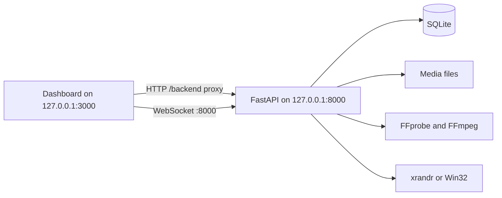

# Architecture

Phase 1 is two processes on one computer.

The dashboard never invents host, display, or media data. Pages for playback, canvas editing, profiles, AI, LED maps, and controllers state the phase in which that work is planned.

## Services in this build

| Area | Module | Behavior |
| --- | --- | --- |
| Web dashboard | `frontend/` | Session, library, display map, monitoring |
| API | `backend/app/main.py` | Auth, health, media, displays, audit |
| Accounts | `backend/app/services/accounts.py` | PBKDF2 passwords, hashed session tokens |
| Media | `backend/app/services/media_store.py` | Store original, probe, thumbnail, optional proxy |
| Displays | `backend/app/services/displays/` | Read-only OS query and desktop bounds |
| Monitoring | `backend/app/routers/ws.py` | Authenticated status socket |
| Capabilities | `backend/app/capabilities.py` | The list the dashboard uses for unavailable features |

## Display detection

Linux runs `xrandr --query` and parses the text. Windows, when the process is actually on Windows, calls `EnumDisplayMonitors`, `GetMonitorInfoW`, `EnumDisplayDevicesW`, and `EnumDisplaySettingsW`. `ChangeDisplaySettings` is not called.

Desktop bounds are the union of connected, placed outputs. That calculation is ordinary code in `geometry.py`. A connector named like `VNC` or `VIRTUAL` is marked virtual. A successful query is not a claim that an LED panel was measured.

The Windows module imports on Linux and raises if called. The Phase 1 automated tests run on Linux, so that path is unexecuted on hardware.

## Media

Upload writes the original bytes, hashes them, and asks FFprobe for one video or image stream. The original is not transcoded. A thumbnail is one frame scaled to 480 pixels wide. An operator can request a separate H.264 proxy with `libx264`. That proxy is a CPU encode. Duplicate bytes return the existing asset.

## Data

SQLite is the only database. A PostgreSQL URL is rejected so the server does not pretend a later driver is present. Tables cover users, sessions, media, transcode jobs, and audit rows. Media bytes live under the configured media directory, outside git.

## Security boundary

- Loopback bind by default
- Cookie session required for every route except `GET /health`
- Roles: admin, operator, viewer
- Login failures are throttled inside the one API process
- Audit records omit passwords and tokens
- Device and GPU commands are fixed strings in code, not text from a request
- No model client and no tool runner

## Later processes

Playback will be a separate process from the API. A Windows service cannot be assumed to open a fullscreen window on a logged-in desktop; that path needs an interactive session. Multi-computer work will use a paired device agent. Sending the same command to several computers is not frame synchronization, and this design does not claim that it is.

Controller profiles, when they exist, will be data. Where a manufacturer does not document a control API, the profile will say that the processor still has to be configured in the manufacturer's tool. Receiving-card firmware is out of scope for automatic writes.
